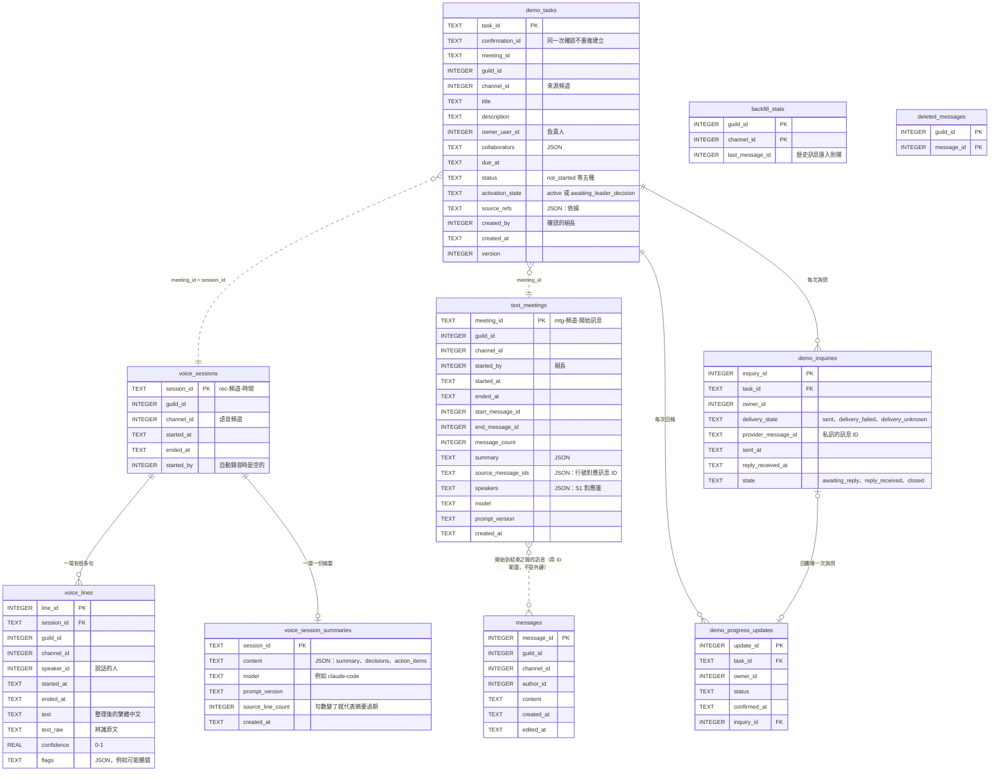

# Bot 資料庫架構

全部存在同一個 SQLite 檔：`discord_bot/data/messages.sqlite3`。這個檔案在 `.gitignore` 裡，不會上傳。

- 時間一律是 UTC 的 RFC 3339 字串。
- Discord ID 存成 INTEGER。傳給 JavaScript 時要轉成字串，因為 JavaScript 的數字裝不下這麼長的 ID。
- 誰可以讀，照「來源頻道」的權限決定（spec R15）。正式讀取一律走讀取介面，例如 `AuthorizedTranscriptReader`。

## 有哪些表

| 群組 | 表 | 誰寫入 | 什麼時候建立 |
|---|---|---|---|
| 語音 | `voice_sessions`、`voice_lines`、`voice_session_summaries` | voice_stt（逐字稿）、meeting_ai（摘要） | 第一次錄完音 |
| 文字訊息 | `messages`、`backfill_state`、`deleted_messages` | 文字記錄（`discord_bot/bot.py` 或 `team_bot/text_logger.py`） | 文字記錄第一次啟動 |
| 文字會議 | `text_meetings` | `/meeting end`（meeting_ai） | 第一次結束文字會議 |
| 追蹤進度（測試） | `demo_tasks`、`demo_inquiries`、`demo_progress_updates` | `/ai tasks` 的「追蹤」按鈕（ai_demo） | 第一次確認追蹤 |

表都是程式第一次用到時才建立的。2026-11-21 時，資料庫裡只有語音的三張表：6 場錄音、115 句、6 份摘要。

## 關係圖

## 每個功能讀哪些表

| 功能 | 讀 | 寫 |
|---|---|---|
| 錄音結束 → 逐字稿 | — | `voice_sessions`、`voice_lines` |
| 錄音結束 → 摘要 | `voice_lines` | `voice_session_summaries` |
| 「查看摘要／逐字稿」按鈕 | 先讀 `voice_sessions` 找到語音頻道，確認權限後讀 `voice_lines`、`voice_session_summaries` | — |
| `/meeting end` | 直接向 Discord 讀這段訊息 | `text_meetings` |
| `/ai` 選會議（打字搜尋） | `voice_sessions`（含句數、有沒有摘要）、`text_meetings`；bot 再過濾掉你看不到的頻道 | — |
| `/ai tasks`、`/ai ask`（語音） | `voice_sessions`、`voice_lines`（照時間排序，重新編號成第 1、2、3… 句）、`voice_session_summaries`；名字從錄音資料夾的 `manifest.json` 讀 | — |
| `/ai tasks`、`/ai ask`（文字會議） | `text_meetings` 拿範圍；原文由 bot 當場向 Discord 讀，不存進資料庫 | — |
| 「追蹤」按鈕、負責人回報 | `demo_tasks` | `demo_tasks`、`demo_inquiries`、`demo_progress_updates` |
| 文字記錄 | — | `messages`、`backfill_state`、`deleted_messages` |
