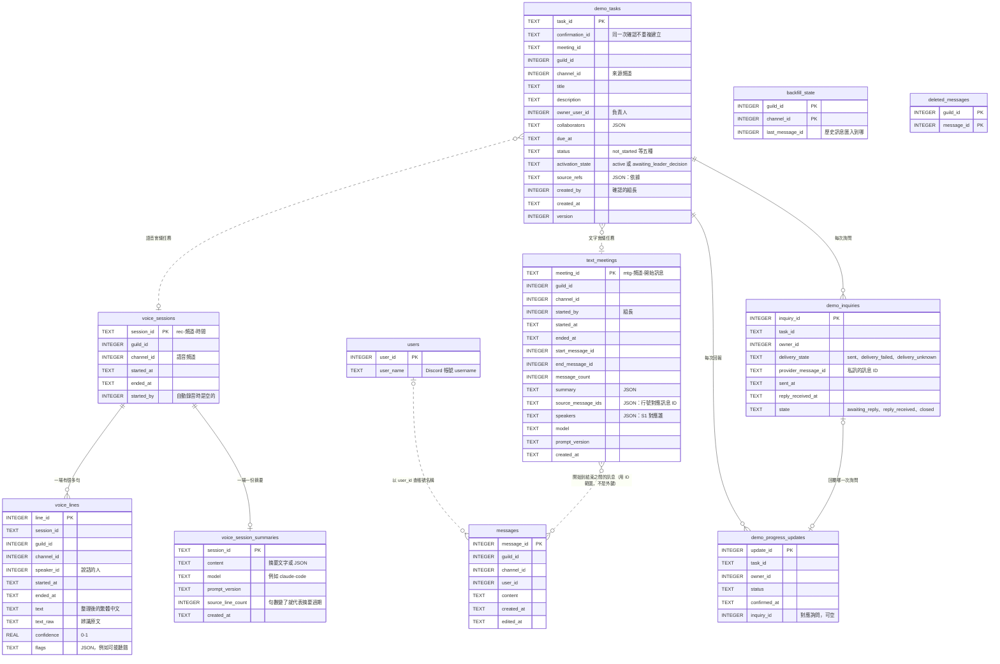

# Bot 資料庫架構

全部存在同一個 SQLite 檔：`data/messages.sqlite3`（可以用根目錄 `.env` 的 `BOT_DB` 改）。這個檔案在 `.gitignore` 裡，不會上傳。

- [sqlite_api.py](../sqlite_api.py) 的 `SQLiteStore` 統一管理資料庫連線、建表、查詢與寫入，包含文字訊息、語音及文字會議，還有測試用的 `demo_*` 追蹤資料。方法簽名見 [SQL_API_README.md](../SQL_API_README.md)。
- `ai_demo` 使用 `SQLiteStore(path, read_only=True)` 查詢會議資料，進度確認、詢問與回報則呼叫同一介面的寫入方法。Discord 使用者的資料讀取依來源權限處理，見 [AI 讀取介面](ai_memory_api.md)。

- 時間欄位以 `TEXT` 儲存。應用程式使用 UTC 的 ISO 8601／RFC 3339 字串。
- 伺服器、頻道、訊息與使用者 ID 通常存為 `INTEGER`。`demo_inquiries.provider_message_id` 存為 `TEXT`。送往 JavaScript 時，超出安全整數範圍的 Discord ID 要轉成字串。
- 誰可以讀，照「來源頻道」的權限決定（spec R15）。正式讀取一律走讀取介面，例如 `AuthorizedTranscriptReader`。

## 有哪些表

| 群組 | 表 | 誰寫入 |
|---|---|---|
| 語音 | `voice_sessions`、`voice_lines`、`voice_session_summaries` | voice_stt（逐字稿）、meeting_ai（摘要） |
| 文字訊息 | `messages`、`backfill_state`、`deleted_messages` | 文字記錄（`text_bot/bot.py` 或 `team_bot/text_logger.py`） |
| 使用者名稱 | `users` | 文字 Bot 登入、成員加入及帳號名稱變更時同步 |
| 文字會議 | `text_meetings` | `/meeting end`（meeting_ai） |
| 追蹤進度（測試） | `demo_tasks`、`demo_inquiries`、`demo_progress_updates` | `/ai tasks` 的「追蹤」按鈕（ai_demo） |

`SQLiteStore(path)` 初始化時會建立缺少的全部 11 張表與索引，並保留既有紀錄。`SQLiteStore(path, read_only=True)` 只開啟既有資料庫供查詢。

## 關係圖

線條表示應用程式依 ID 或範圍建立的資料關聯。`PK` 表示 SQLite 宣告的主鍵，表與表之間的關聯及跨表刪除由應用程式管理。

## 查詢索引

| 索引 | 欄位 |
|---|---|
| `messages_by_channel` | `guild_id`、`channel_id`、`created_at` |
| `voice_sessions_by_channel` | `guild_id`、`channel_id`、`started_at` |
| `voice_lines_by_session` | `session_id`、`started_at` |
| `text_meetings_by_channel` | `guild_id`、`channel_id`、`started_at` |

## 每個功能讀哪些表

下表包含暫停的指令所使用的資料表。目前可用指令見 [Team Bot 使用說明](../team_bot/README.md#指令)。

| 功能 | 讀 | 寫 |
|---|---|---|
| 錄音結束 → 逐字稿 | — | `voice_sessions`、`voice_lines` |
| 錄音結束 → 摘要 | `voice_lines` | `voice_session_summaries` |
| 「查看摘要／逐字稿」按鈕 | 先讀 `voice_sessions` 找到語音頻道，確認權限後讀 `voice_lines`、`voice_session_summaries` | — |
| `/meeting end` | 直接向 Discord 讀這段訊息 | `text_meetings` |
| `/ai` 選會議（打字搜尋） | `voice_sessions`、`voice_lines`、`voice_session_summaries`、`text_meetings`。Bot 依來源頻道權限篩選 | — |
| `/ai tasks`、`/ai ask`（語音） | `voice_sessions`、`voice_lines`（照時間排序，重新編號成第 1、2、3… 句）、`voice_session_summaries`；名字從錄音資料夾的 `manifest.json` 讀 | — |
| `/ai tasks`、`/ai ask`（文字會議） | `text_meetings` 提供範圍與摘要，原文由 Bot 向 Discord 讀取。Discord 回傳空清單時使用已保存摘要 | — |
| `/summary_this_channel`、含頻道歷史的 `/ask` | 驗權後從 `messages` 取得目前頻道最多 100 則文字 | — |
| 一般 `/ask` | 只使用問題本身 | — |
| 確認追蹤與記錄詢問 | `demo_tasks` | `demo_tasks`、`demo_inquiries` |
| 負責人回報 | `demo_tasks`、`demo_inquiries` | `demo_tasks`、`demo_inquiries`、`demo_progress_updates` |
| `/ai tracked` | `demo_tasks`。Bot 依來源頻道權限篩選 | — |
| 文字記錄 | `messages`、`backfill_state`、`deleted_messages` | `messages`、`backfill_state`、`deleted_messages` |
| 同步及查詢使用者名稱 | `users` | `users` |
